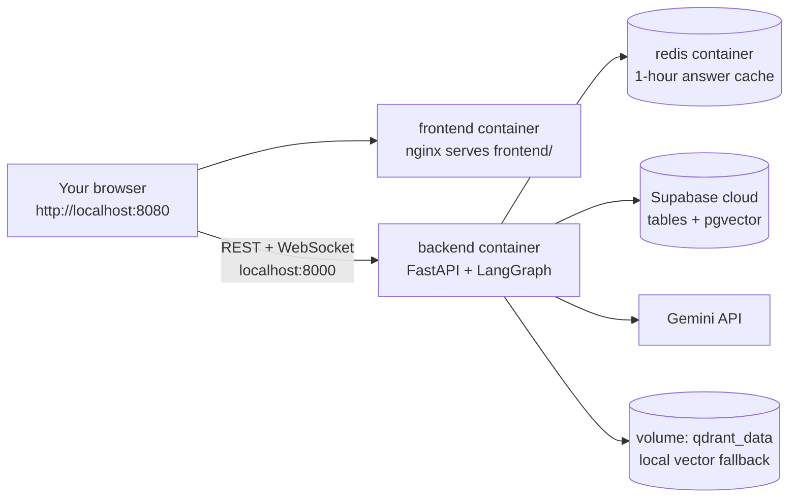

# Dockerising ResolveX (no SaaS, just a clean, portable setup)

> These files were written from your code but **not build-tested here** (no Docker in my sandbox). Run the steps below once and send me any error text; fixes are usually one line.

## 1. What you get



Three containers started by one command. Supabase and Gemini stay in the cloud, so the only secrets you need are in `.env`.

## 2. Where to put the files

Copy these into the **root of your repo** (next to `requirements.txt`):

```text
ResolveX/
  Dockerfile
  docker-compose.yml
  .dockerignore
  .env              <- your real keys (never committed, never baked into the image)
  Backend/  frontend/  data/  requirements.txt ...
```

## 3. Run it

```bash
# 0. make sure .env exists (copy from .env.example) with NEW rotated keys:
#    SUPABASE_URL, SUPABASE_PUBLISHABLE_KEY (and SUPABASE_SECRET_KEY), GEMINI_API_KEY

docker compose build            # first build takes a few minutes
docker compose up -d            # start all 3 containers
docker compose ps               # all should say running / healthy
docker compose logs -f backend  # watch the server logs

# open the app
#   chat UI   : http://localhost:8080
#   API docs  : http://localhost:8000/docs
#   health    : http://localhost:8000/health

docker compose down             # stop everything
```

Useful extras:

```bash
docker compose build --no-cache backend       # rebuild from scratch
docker compose exec backend python -m Backend.rag.ingest   # (re)fill local Qdrant inside the container
docker compose run --rm backend pytest -q     # NOTE: tests/ is excluded from the image; see section 5
```

## 4. What each file does (line-by-line idea)

**Dockerfile**
1. `FROM python:3.12-slim`: small Python base.
2. `COPY requirements.txt` + `pip install` **before** copying code: Docker caches this layer, so rebuilds are fast unless dependencies change.
3. `Ranker(model_name='ms-marco-TinyBERT-L-2-v2')`: downloads the FlashRank reranker model during build, so the first user question is not slow.
4. `COPY Backend`, `COPY data`: app code and the policy PDFs / mock data. `.env` is **not** copied.
5. `USER appuser`: runs as a normal user (safer than root).
6. `HEALTHCHECK`: calls `/health` so Docker knows if the app is alive.
7. `CMD uvicorn ...`: starts the server on `$PORT` (default 8000). One worker on purpose, because the circuit breaker and visitor counter live in process memory.

**.dockerignore**: keeps `.env`, `.git`, tests, docs and caches out of the image (smaller and no leaked secrets).

**docker-compose.yml**
- `redis`: the cache. Saving to disk is turned off because it is only a cache.
- `backend`: built from the Dockerfile, reads `.env`, and gets `REDIS_URL=redis://redis:6379/0` (containers reach each other by service name, not `localhost`). Starts only after Redis is healthy.
- `frontend`: plain nginx showing your `frontend/` folder. `config.js` already points to `http://localhost:8000` when the page is opened from `localhost`, so no code change is needed.
- `qdrant_data` volume: keeps the local vector store between restarts.

## 5. Things to decide or fix (small, but they matter)

| Item | What to do |
|---|---|
| **Rotate your keys first** | Your old keys were in the zip you shared. Create new ones before anything else. |
| Tests | `tests/` is excluded from the image to keep it small. Run tests on your machine with `pytest -q`, or make a second build stage / `Dockerfile.test` if you want them in Docker. |
| Supabase must already be set up | The container does not create tables. Run the 3 SQL migrations in the Supabase SQL editor and load your embeddings first. |
| Visitor counter | `data/visitor_count.txt` is excluded from the image, so the count starts fresh in each new container. Fine for a demo. |
| CORS | Default is `*`. For a real deployment set `CORS_ORIGINS=https://your-frontend-domain`. |
| Redis password / cloud Redis | If you use Upstash or a password, set `REDIS_URL` in `.env` and delete the `redis:` service and the `REDIS_URL` line in compose. |
| WebSockets behind a proxy | If you later put nginx or a cloud load balancer in front, enable WebSocket upgrade headers. |
| Scaling | Don't add more uvicorn workers until the circuit breaker and visitor counter move to Redis. |

## 6. Common errors

| Error | Cause | Fix |
|---|---|---|
| `backend` exits immediately, log mentions Supabase/Gemini key | `.env` missing or empty values | create `.env` in repo root, `docker compose up -d --build` |
| Chat page loads but shows "disconnected" | backend not healthy yet, or port 8000 busy | `docker compose logs backend`; free the port |
| Answers are slow on first request | model/cold start | normal once; the reranker is already baked into the image |
| `port is already allocated` | something else uses 8000 or 8080 | change the left number in `ports:` e.g. `"8001:8000"` (and open the page via that port; also update `config.js` if you change the backend port) |
| Redis connection warnings | Redis container not running | `docker compose ps`; the app still works without Redis (cache is fail-open) |

## 7. Optional next step: push the image

```bash
docker build -t yourdockerhubname/resolvex-backend:1.0 .
docker push yourdockerhubname/resolvex-backend:1.0
```

Then Render, Railway, Fly.io or Google Cloud Run can run that image directly.
